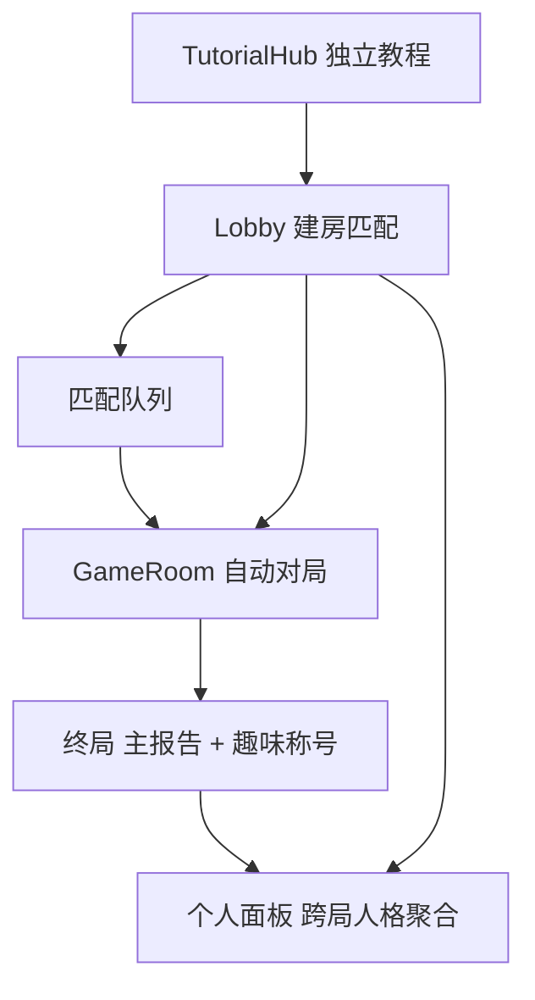

# 产品演进方向（光阴对赌）

> **状态**：草案 · 可能发展  
> **最后更新**：2026-10-07

本文记录产品**尚未实现、亦非排期承诺**的演进想法，供规则讨论与开发对齐使用。**不改变**当前以真人主持人配合 Admin 后台开局的线下/混合玩法；现网行为以代码与玩家手册为准。

**北极星（产品壳层）**：长期做成类似**线上狼人杀**的独立产品形态——教程、大厅进房、匹配开局、自动推进对局、终局轻量娱乐反馈与个人成长档案分工清晰；§1 描述对局内自动化能力，§3 描述这一壳层与账号层体验。

---

## 1. 去主持人，完整线上对局（系统 cue）

### 目标体验

在合适的时机演进为**无需真人主持**的完整线上对局：房间创建 → 凑人 → 开局 → 时代介绍 → 道具（Buff）→ 投资倒计时 → 结算 → 拍卖 / 换代 → 终局，由**服务端状态机**推进阶段，前端以引导文案、动效与检查清单完成「cue」，玩家只需在客户端操作。

### 与现状的关系

当前为**混合模式**：

- 玩家就绪、投资完成、倒计时结束等会触发 `server/state/phaseController.ts` 中的 `tryAdvancePhase`。
- 开局、教程步进、跳阶段、踢人、解锁、散房及部分异常干预仍依赖 Admin Socket（如 `server/network/socketHandlers.ts` 中的 `adminStartGame`、`adminSkipPhase` 等）。
- 玩家端等候页仍提示「等待主持人开始游戏」（`frontend/src/views/RoomWaiting.tsx`）。

演进方向是**复用并强化**已有 `phaseController`、`server/state/actionTimeExpiry.ts`、投资截止等自动化能力，逐步将每局必需的主持操作替换为系统规则；Admin 可收缩为**纯运维**能力（观战、场次导出、素材上传、内容配置等），`ADMIN_TOKEN` / 管理子域保留给运营，而非每局必登。

以下五项是「完整线上产品」体验的核心增量（与阶段自动化并列，可分期交付）。

### 1.1 新手教程：对标成熟产品，侧栏一体，正式局前试验轮

**目标**

- 新玩家**不依赖主持人口述**即可理解：时代主题、精力表、三类项目、投资提交、结算与拍卖、道具时机、聊天与转账等。
- 老手可跳过或折叠，避免重复打断。

**对标思路（产品层，非排期）**

参考成熟线上桌游 / 派对游戏常见做法：

- **分阶段解锁**：先概念（读）→ 再交互（点）→ 再短局（做），每步有明确完成条件与进度条。
- **情境化提示**：在真实 UI 上出现高亮与一句说明，而非纯 PPT；错误操作给出可恢复反馈。
- **可随时查阅**：进行中任意阶段可打开同一套说明，与「当时教你的」一致，减少记忆负担。

**与现状的关系**

- 已有主持驱动的 `TUTORIAL` 阶段（`adminTutorialNext` / `adminStartTutorial`）、幻灯片 `frontend/src/tutorialData.ts`、各 `tutorial/demos/*` 动手 demo，以及侧栏 `PlayerGameHelp`（`guide` 等 tab，配置在 `playerHelpReference.ts`）。
- 缺口：教程与侧栏**文案/结构未强制同源**；教程需主持推进；**没有**计入正式 session 之外的「试验轮」房间。

**演进要点**

| 维度 | 方向 |
|------|------|
| 内容同源 | 教程步骤、侧栏「指南」、局内帮助表（项目/道具）共用一套结构化数据源（标题、要点、demo 键、关联规则 ID），改一处全站同步。 |
| 侧栏入口 | 保留并强化 `PlayerGameHelp` 侧栏 rail：教程进行中与正式对局使用相同 tab（指南 / 结算记录等），教程页可 `embedInTutorial` 内嵌 demo，正式局点击同一 tab 看到一致正文。 |
| 自主推进 | 玩家客户端完成「下一步 / 我懂了」即可推进（服务端校验步骤），替代 Admin 逐步点 Next；主持教程保留为线下活动可选能力。 |
| **试验轮** | 在 `ROOM_WAITING` 凑人后、或全员确认后，进入**短局沙盒**（建议独立 phase，如 `PRACTICE`）：固定 1 个时代、少量项目、假 NPC 或镜像 bot，走完「投资 → 结算」一次；**不计入**正式 `session` 财富与决策基因；通过后或老手勾选跳过，再进入 `ERA_INTRO` 正式第一代。 |
| 验收 | 无主持情况下，6 人新房间从进入到完成试验轮（或跳过）并自动开正式第一代，全程可仅靠侧栏 + 系统 cue。 |

**试验轮待决**

- 是否与现有 `TUTORIAL` 幻灯片合并为一条 onboarding 流水线，还是「幻灯片 → 试验轮」两段。
- 跳过资格：账号级「已完成教程」标记 vs 每房间房主强制新人完成。
- 试验轮是否复用 `tutorialMock.ts` 数据或单独 `practice` 配置。

### 1.2 社交：稳定的私聊、群聊、转账与统一入口；开局全场大群（群聊基础能力已落地）

**目标**

- 谈判、结盟、转账与道具联动成为**默认可用**的线上能力，入口清晰、状态可预期（未读、待确认转账、禁言阶段）。
- **开局即有「全场」大群**（现命名「全场」，`PUBLIC_GROUP_ID`），全员真人自动入群，无需主持手动建群。

**与现状的关系（2026-11-05）**

- 已落地：`GROUP_CHAT_ENABLED = true`；房间有真人后 `syncChatGroupsOnRosterChange` 自动 `ensurePublicChatGroup`，新一局 `resetGameSession` 后自动重建；前端 dock 固定展示「全场」，并排在群聊区最前。
- 前端：`PlayerChatSystem`（私聊线程、全场/自定义群、转账 composer、dock 未读与待确认提示）。
- 服务端：私聊与 `resolvePendingTransfer`、群聊 CRUD（`server/logic/chatGroups.ts`）；禁聊阶段仍为 `ROOM_WAITING / ERA_INTRO / TUTORIAL`；单群保留 500 条、单次广播最近 200 条。
- 群聊总开关：`GROUP_CHAT_ENABLED`（`server/config/playerChatFeatures.ts`）与前端 `PLAYER_GROUP_CHAT_ENABLED` 需同步；关闭时 Socket 直接拒绝群相关操作。

**演进要点**

| 维度 | 方向 |
|------|------|
| 全场大群 | ✅ 已有真人即自动创建；新人入房 / 断线重连后同步成员；前端 dock 固定展示「全场」，排在群聊区最前。 |
| 私聊 | 1v1 线程稳定：断线重连后拉取历史、未读与 `chatSeenStorage` 一致；与转账同会话展示（已有 demo：`DemoTransferAndMessage`）。 |
| 群聊 | 玩家自建小群保留上限与命名规则；创建/改名/踢人/解散的权限与审计日志明确；敏感词与 `forbiddenText` 策略线上一致。 |
| 转账 | 发起 → 对方确认 / 拒绝 / 超时；与财富校验、拍卖阶段是否允许转账的规则表对齐；**入口**：侧栏活动项、聊天 composer、玩家头像快捷菜单（待 UI 定稿）多处同能力。 |
| 稳定性 | 消息顺序、幂等、限流；Admin 观战只读与纠纷导出沿用 `sessionExport` 中的 `chatGroups` / 交易记录。 |
| 阶段策略 | 明确「从何时可聊」：例如等候室仅全场禁言或仅系统公告；进入试验轮或正式第一代后开放群聊与私聊（需与谈判玩法平衡）。 |

### 1.3 彩票：线上开奖（替代实体骰 + 主持输入）✅ 已落地

**目标**

打出「彩票」道具后，**系统**根据规则掷骰（或等价 RNG）得出面额，全服可见过程与结果，玩家确认入账；不再依赖主持人物理骰子与 Admin 填金额。

**与现状的关系**

- 已实现：玩家打出彩票后，服务端调用 random.org（失败退回 `crypto.randomInt`）掷 1–6 点，按 0/30/60/90/120/200 查表；前端 `LotteryConfirmModal` 播放骰子动画后确认入账。
- 系统自动主持会为离线/超时未确认的玩家自动领取；Admin 仍保留手动开奖作为修正入口。
- 导出记录 `enteredAmount / creditedAmount / goldApplied / roll / source`；点石成金 1.5 倍取整逻辑不变。

**演进要点**

| 维度 | 方向 |
|------|------|
| 触发 | 玩家在 Buff 阶段声明彩票后，进入「待开奖」状态；或结算页统一排队开奖（与打火机等待判定节奏协调）。 |
| 随机与面额 | 将桌游骰子结果映射为**公开查表**（如点数 → 财富区间），服务端 `crypto` 随机并写入 `game.logs` + session 事件；前端全屏或 modal 动画展示骰子/点数（可复用 `LotteryConfirmModal` 改为「系统已开奖，确认领取」）。 |
| 去掉上帝输入 | 废弃或仅保留 Admin **观战回放**用的手动 override；正常对局禁止人工改金额。 |
| 公平与可见 | 同房间所有玩家可见开奖动画或结果条；当事人仍需确认以防误触（或改为倒计时自动确认，待决）。 |
| 文案 | 道具说明、玩家帮助、教程 demo 同步改为「系统掷骰开奖」。 |

### 1.4 虚拟主持人拍卖 ✅ 已落地（自动主持）

**目标**

- 进入 `AUCTION` 后，由**系统扮演拍卖师**（可配合固定人设文案 / 轻量动效，即「虚拟主持人」）：报场次、亮当前 lot、倒数或静默落槌、宣布成交/流拍，并自动进入下一张或结束拍卖进入下一代。
- 玩家侧仅保留**公开加价**（`playerPlaceAuctionBid`）与规则内**强买强卖**；不再依赖 Admin 点「改成拍这张」「确认成交」「跳过」。

**与现状的关系**

- 卡池与场次：`AUCTION_CARD_IDS_BY_ROUND` 按 `currentEra` 映射第 1～3 场拍卖；起拍价 5、加价步长 5（`AUCTION_STARTING_BID` / `AUCTION_BID_INCREMENT`）。
- 玩家出价与领先价、财富占用逻辑已在 `server/logic/auctionCards.ts`（`placeAuctionBid`、`hammerAuctionLot`、`passAuctionLot`、`advanceAuctionFocus`）。
- 进入拍卖时 `beginAuctionSession` 会重置本场状态，但**故意不设** `auctionFocusCardId`——注释写明「由主持手动点改成拍这张」；前端 `AuctionView` 在全部成交后会提示等待主持人结束拍卖。
- 主持专用 Socket：`adminSetAuctionFocus`、`adminHammerAuction`、`adminPassAuction`，以及成交撤回等上帝操作（`socketHandlers.ts`）；成交后全房 `playerNotify`（`auction_sold`）。
- 教程有 `DemoAuction` / `tutorialMock` 拍卖试玩，但正式局仍靠 Admin。

**演进要点**

| 维度 | 方向 |
|------|------|
| 开场 cue | 进入 `AUCTION` 后虚拟主持人播报本场时代、第几场、待拍列表；`beginAuctionSession` 后**自动**将焦点设为 `findNextAvailableAuctionCard` 的第一张（或按配置固定顺序），替代人工点焦点。 |
| 竞价节奏 | 每张卡维护「最后一次有效加价时间」；无人出价时短倒计时后**流拍**（`passAuctionLot`）或按规则重试；有领先价时延长倒计时，到期自动 `hammerAuctionLot` 落槌。 |
| 叙事层 | 系统日志 + 玩家屏顶部/拍卖页文案统一口播模板（「下一件是…」「当前最高 X，还有 Y 秒」）；人设可仅文案，不强制语音。 |
| 下一件 | 落槌或流拍后自动 `advanceAuctionFocus`；池内无可用卡时虚拟主持人宣布本场结束，`tryAdvancePhase` 进入 `ERA_INTRO` 等下一阶段（与 `phaseController` 衔接）。 |
| 强买强卖 | 保持拍卖阶段对**当前焦点卡**使用；虚拟主持人落槌前可冻结倒计时，避免与加价竞态（规则与现网一致）。 |
| Admin 边界 | 正常对局禁止人工改焦点/落槌；Admin 仅观战、异常回放或线下活动「接管拍卖」开关（可选）。 |
| 教程对齐 | 试验轮 / 侧栏拍卖说明与线上自动节奏一致；`DemoAuction` 可模拟倒计时与自动落槌。 |

**待决**

- 流拍是否消耗该卡本轮资格，还是稍后重拍。
- 同一张卡无人出价是否允许以起拍价「底价成交」给某默认规则（通常否）。
- 倒计时秒数是否随场次或在线人数配置；掉线玩家领先价是否自动作废。
- 虚拟主持人形象：纯文字条 vs 固定 NPC 立绘/头像（不影响服务端状态机）。

### 1.5 玩家离线：对局内其他人要有明显提醒

**目标**

- 任一玩家**掉线 / 主动离房 / 长时间无响应**时，其余在局玩家能立刻感知：谁离线、从何时起、是否影响当前阶段（例如「不挡进度」仍要说明），重连后也有统一提示。
- 避免线下主持人口头报「某某断线了」；线上靠 UI + 可选系统消息，减少误等、误投、拍卖误判。

**与现状的关系**

- 服务端：`disconnect` 与离房逻辑会将 `player.connected = false`，`broadcastUpdate` 同步状态；`appendSessionEvent(..., "presence", presencePayload(..., "disconnect", ...))` 写入场次 telemetry（供导出，**不**等同于玩家即时弹窗）。
- 规则：就绪 / 投资完成等门槛只计**在线**真人（`gameActions.ts`）；侧栏说明「离线玩家不挡进度」（`playerHelpReference.ts`）；`autoFinishDisconnected` 等会把离线者视为本阶段已完成（`roomState.ts`）。
- 玩家端：`ConnectionGate` 只处理**自己**的 Socket 连接；除等候室按在线人数展示外，**缺少**全局面板上持续的离线标记与他人离线的主动提醒（Admin 后台玩家列表有「离线」文案）。
- 重连：同昵称回座（`LeaveGameButton` 文案）；`presence` 含 `rejoin` / `reconnect`，但其他玩家端未必有显著 toast。

**演进要点**

| 维度 | 方向 |
|------|------|
| 即时提醒 | 他人 `disconnect` / `leave` 时向同房在线玩家推送 `playerNotify`（或专用 `presenceBroadcast`）：「【昵称】已离线」；重连时「【昵称】已回到对局」。 |
| 持久状态 | 玩家列表 / 头像条 / 投资页同桌区统一展示离线样式（灰显、标签、最后在线时间可选）；状态随 `game.players[].connected` 更新，全阶段可见。 |
| 全场频道 | 若已启用 §1.2 全场大群，可选插入一条**系统消息**（非玩家发言）：离线/重连，便于扫聊天记录的人补上下文。 |
| 情境文案 | 按 `phase` 补充一句影响说明，例如投资倒计时：「其未提交不会阻止进入结算」；拍卖：「其领先出价是否保留」与 §1.4 待决一致；就绪阶段：「仅需在线玩家全部就绪」。 |
| 重复与骚扰 | 同一玩家短时闪断合并为一条提醒；提供「不再提示本局离线」或仅保留列状态、不弹窗（待决）。 |
| Admin | 主持观战列表与玩家端展示口径一致；telemetry `presence` 事件保留供复盘。 |

**待决**

- 断线判定：Socket 断开即离线 vs 心跳宽限（例如 15s）再标离线，减少误报。
- 主动「暂离」与异常断线是否区分展示。
- 离线者在拍卖领先、待确认转账、待确认彩票等挂起态下的提示是否要额外高亮给**全桌**。

### 系统 cue 与其余待决

- 房间由谁创建、最低人数；AFK 策略与 §1.5 宽限、拍卖领先等规则一并定稿。
- 除 §1.3、§1.4 已述环节外，其余「主持在场」操作统一为系统推进 + 日志。
- 各阶段系统旁白与无障碍：与侧栏指南、试验轮提示共用文案源。

### 数据与测量

若落地全自动对局，主持人打的社交档 `socialRank` 等字段可能**废弃**或改为系统 / 同伴评价；届时需同步修订 [数据留存与导出说明.md](数据留存与导出说明.md)。

---

## 2. 项目行为对「时代主题」出现的影响

### 动机

让人类四代（青年 → 壮年 → 中年 → 老年）之间的**世界观主题**（气候 / 科技 / 文化 / 健康 / 心理）不只由预定序列决定，而可能受局内**集体投资与项目结果**塑造，增强因果叙事与重玩差异。

### 现状锚点

- 人生阶段由 `currentEra` 推进；每代**主题卡**来自开局预定的 `eraSequence`，经 `server/state/gameEra.ts` 的 `updateEraCard` 写入 `currentEraCard`。
- 发牌：`drawProjectsForEra` 中短/长期项目当前从全池随机抽取；**风险项目**仍要求 `p.era === currentEraCard.era`。
- 项目卡自带 `era` 标签，见 `frontend/src/config/projectCatalog.ts`（与前端展示、帮助表一致）。

### 可能机制（可多选，均未定）

- 按局内累计精力、财富或完成项目在五大 `era` 标签上的分布，**加权**抽取或影响下一主题卡。
- 完成特定长期项目后，解锁或加权某一主题（可与 `server/logic/longTermLogic.ts`、结算 telemetry 挂钩，便于复盘与数值平衡）。
- 玩家投票或社区命名阶段与主题演化联动（需与终局流程协调）。

### 设计注意

- 与四代节奏、换代时风险项目清理、卡池体量之间的平衡。
- 是否需要「保底」或上限，避免单局极端偏科导致后续几代体验崩坏。

### 数据

若实现，应在 session 导出中留存**主题演化依据**（输入特征与结果），遵循 [数据留存与导出说明.md](数据留存与导出说明.md) 中「只记事实、方便导出」的原则；具体字段待设计时再定。

---

## 3. 愿景：类线上狼人杀的产品壳层

整体理想形态：**玩家打开 App / 网页 → 先完成独立教程（可选跳过）→ 在大厅创建或匹配房间 → 人满或就绪后系统自动开局 → 对局结束进入结果页与趣味称号 → 随时打开个人面板查看跨局投资人格与偏好**。与 §1「去主持人、系统 cue」一致，但本节强调**入口、匹配、账号层与社交娱乐包装**，而非单房间 Socket 细节。

### 3.1 独立教程 · 独立进房 · 匹配 · 开局

**目标体验**

| 模块 | 类比（狼人杀类） | 光阴对赌期望 |
|------|------------------|--------------|
| 教程 | 规则课 + 练习房，与真局隔离 | 独立入口与进度（不与某房间号绑定）；内容见 §1.1（侧栏同源 + 试验轮） |
| 进房 | 建房 / 输入房号 / 好友房 | 保留熟人房号；另提供「快速开始」公开房间列表（可选密码） |
| 匹配 | 排位或休闲匹配队列 | 按人数（如 6 人）、模式（标准 / 新手）入队；凑满后**自动建局**并跳转对局，无需 Admin 点开局 |
| 开局 | 房主点开始或倒计时 | 全员就绪或匹配成功 → 服务端 `adminStartGame` 等价逻辑改为**房间自治**（房主仅配置，不主持流程） |

**与现状的关系**

- 玩家主路径：`Lobby` 输入昵称 + 房间号 `joinGame`（`frontend/src/views/Lobby.tsx`），无全局匹配队列。
- 教程：`TUTORIAL` 阶段嵌在房间内，由 Admin 推进（§1.1）。
- 开局：仍依赖 `adminStartGame`；等候文案为「等待主持人开始」。

**演进要点**

- 应用壳分层：**大厅（Lobby）** / **教程（TutorialHub）** / **对局（GameRoom）** 路由分离；教程完成状态存账号或设备（与 §1.1 跳过策略一致）。
- 匹配服务（可后期）：内存队列 → 持久化；匹配成功下发 `roomId` + 自动 `joinGame`；掉线回队列策略与 §1.5 联动。
- 真局与教程、试验轮**数据隔离**：仅 `session_archive` / 导出中的正式场次计入排行榜与人格档案。

**待决**

- 是否必须账号登录（手机 / 微信）才能匹配，还是昵称 + 重连 token 即可。
- 跨区延迟、人数不足时是否用 AI 补位（与现 `adminAddAI` 能力关系）。

### 3.2 终局趣味小称号（娱乐层）

**目标**

- 在严肃「决策基因 / 命运素描」主结论之外，增加**一局一发的轻量称号**，营造狼人杀式复盘笑点——例如行为与主类型反差时的「假守卫」「纸面长线人」等（名称与文案待策划，**调侃向、不做人身攻击**）。
- 称号在结果页醒目展示、可一键分享；与财富排名、社区命名并列，但不替代规则引擎给出的 `primaryPersona`。

**与现状的关系**

- 终局页 `GameOver` 已展示财富榜、雷达图、主类型 `primaryPersona`、PDF 等；`PersonaReportSections` 有「次要命运素描」`secondaryFateSketches`（本场得分次高的几类），语气偏分析而非梗。
- 规则引擎输出见 `server/logic/analysisLogic.ts` → `player.analysisResult`；场次归档含 `fatePersona`（`sessionArchive` / `sessionExport`）。

**演进要点**

| 维度 | 方向 |
|------|------|
| 生成逻辑 | 基于本场 telemetry + `analysisResult` 规则表：反差（主类型 vs 行为峰值）、极端行为（全场唯一抢风险、全场最高转账次数）、社交名场面等触发不同梗称号；可一局多枚或主梗 + 副梗。 |
| 与主报告关系 | **娱乐层**可打脸或自嘲；**测量层**仍以 [决策基因系统设计文档.md](决策基因系统设计文档.md) 与规则引擎为准，避免玩家误以为梗称号是科学结论。 |
| 呈现 | 结果页动画、全场公屏滚动；可选「称号图鉴」收集（账号层，见 §3.3）。 |
| 数据 | 每场写入 session 导出：`funTitles: string[]` 及触发依据（方便日后调梗密度）。 |

**待决**

- 是否允许玩家对称号「换一张」或隐藏；敏感词与负面标签边界。
- 与主持人 `socialRank` 若并存时，优先级与展示位置。

### 3.3 个人面板：跨局「被判定过」的投资人格与偏好

**目标**

- 每位玩家有**个人主页 / 面板**（非单局终局页）：汇总多局以来规则引擎（及可选 LLM 辅助文案）给出的**投资人格 / 命运素描类型**；看清「哪些类型判过我、哪几类出现得最多」，形成稳定的**偏好画像**（长线偏多、更爱风险、社交型转账等），类似狼人杀战绩 + 身份统计，但基于行为而非自报。

**与现状的关系**

- **单局**：终局 `analysisResult`（主类型 `primaryPersona`、维度分 `scores`、`mbtiPersona` 等）、雷达与维度条、本场百分位（`sessionDimensionPercentiles`）。
- **跨局**：已完成场次写入 `server/data/session_archive.json`，导出含 `fatePersona` / `geneCode` / `ruleEnginePersona`；**尚无**玩家账号维度的聚合 UI 与 API。
- 设计依据与 16 型矩阵见 [决策基因系统设计文档.md](决策基因系统设计文档.md)。

**演进要点**

| 维度 | 方向 |
|------|------|
| 身份键 | 登录账号 ID，或长期绑定的 `playerProfileId`（昵称可变、历史归并策略待定）。 |
| 聚合内容 | 各 `primaryPersona`（及可选次要素描）出现次数、占比、最近 N 局趋势；四维 L/Q、A/G、D/C、V/R 的滑动平均或分布直方图。 |
| 「被判定更多」 | 面板突出 Top 3 类型 + 「罕见类型」；用文案解释「你常在局中被判为…，因为你在长期项目上的精力占比偏高」等（消费导出特征，非空泛 MBTI）。 |
| 与单局关系 | 对局内仍只看本场报告；面板入口在大厅头像、终局「查看我的档案」。 |
| 隐私 | 默认仅自己可见；可选公开名片（只展示类型分布、不展示财富）供好友匹配。 |
| 数据管道 | 社区命名 / 终局分析完成后从 `session_archive` 或实时归档事件增量更新用户画像表；原则同 [数据留存与导出说明.md](数据留存与导出说明.md)。 |

**待决**

- 是否展示「他人眼中的你」（若未来有投票选类型玩法）与引擎判定并列。
- 老场次无 `analysisResult` 时是否回填或跳过。
- 与 §3.2 梗称号：面板是否收集「梗称号图鉴」与「正式人格分布」分栏。

### 3.4 模块关系（示意）

---

## 变更记录

| 日期 | 摘要 |
|------|------|
| 2026-09-29 | 初稿：记录「系统 cue / 去主持人」与「项目影响时代主题」两条方向 |
| 2026-10-07 | 扩充 §1：新手教程（侧栏同源、试验轮）、社交（全场大群/转账入口）、彩票线上开奖 |
| 2026-10-07 | 增补 §1.4：虚拟主持人拍卖（自动焦点、倒计时落槌、结束场次） |
| 2026-10-07 | 增补 §1.5：玩家离线时对其他人的提醒（通知、列表状态、情境文案） |
| 2026-10-07 | 新增 §3：类线上狼人杀壳层（教程/匹配/开局、趣味称号、个人人格面板） |
